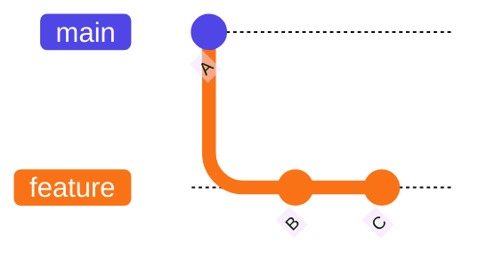
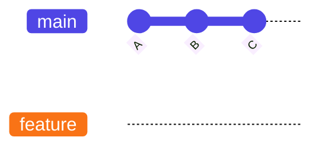
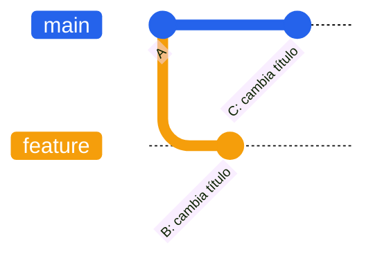
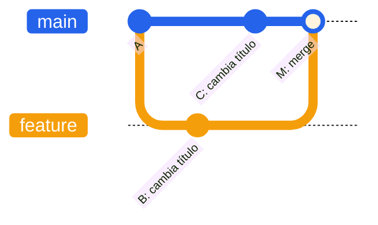
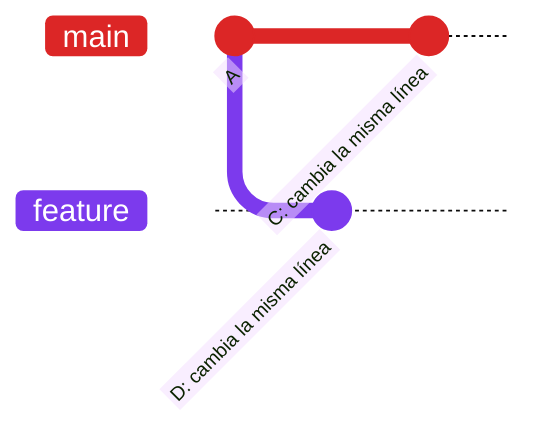
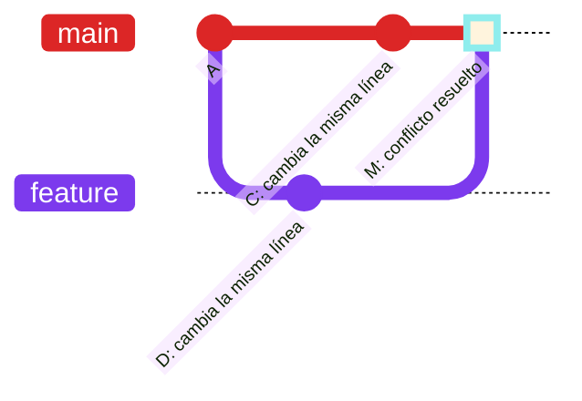

# Práctica: los tres escenarios de `git merge`

**Módulo:** Entornos de Desarrollo · **Curso:** 1.º DAM  
**Modalidad:** individual o por parejas · **Herramientas:** Git, VS Code y Markdown

## Objetivo

Reproducir **tres escenarios de integración de ramas** en Git, observar qué sucede en el historial y explicar **por qué** se produce cada resultado:

1. **Fast-forward** (avance rápido).
2. **Merge commit** (integración de historiales divergentes).
3. **Merge con conflicto** (detección y resolución de cambios incompatibles).

No se trata de memorizar comandos: se trata de **preparar las condiciones**, ejecutar la integración y comprobar el resultado.

> **Uso de IA:** podéis consultar un chatbot para entender conceptos, buscar comandos o interpretar errores. Sin embargo, debéis ejecutar vosotros las operaciones, comprobar el historial y redactar las explicaciones con vuestras palabras. Debéis poder defender lo que habéis hecho.

## Antes de empezar: conceptos básicos

- **Commit:** instantánea de los cambios registrados en el repositorio.
- **Rama:** referencia que apunta a un commit y avanza con nuevos commits.
- **`main`:** rama principal de nuestros ejercicios.
- **`merge`:** operación que integra el historial de otra rama en la rama actual.
- **Antepasado común:** commit del que parten dos líneas de desarrollo.

En los diagramas, cada nodo representa un commit. Los nombres `A`, `B`, `C`… son ilustrativos, no hashes reales.

## Escenario 1. Fast-forward

Un *fast-forward* es posible cuando la rama actual **no ha recibido commits nuevos** desde el punto del que partió la otra rama. Git puede simplemente avanzar la referencia de la rama actual hasta el commit más reciente, **sin crear un commit de merge**.

**Antes de integrar:**



**Después de integrar:**



**Condición clave:** el commit al que apunta `main` es antepasado del commit al que apunta `feature`.

**Vuestro reto:** preparad un repositorio donde al integrar una rama en `main` se produzca un fast-forward. Demostrad que **no apareció ningún commit de integración**.

## Escenario 2. Merge commit

Si ambas ramas han avanzado desde su antepasado común, sus historiales **han divergido**. Una integración normal puede reunirlos creando un nuevo commit con **dos padres**, uno por cada línea de desarrollo.

**Antes de integrar:**



**Después de integrar:**



**Condición clave:** `main` y `feature` tienen commits diferentes después del antepasado común. Para esta práctica, **no forcéis** la creación del commit con opciones como `--no-ff`: queremos que sea consecuencia de la divergencia.

**Vuestro reto:** preparad dos ramas con historiales divergentes, integradlas y localizad el commit de merge en el historial.

## Escenario 3. Merge con conflicto

Un conflicto puede aparecer cuando Git **no sabe combinar automáticamente** cambios incompatibles, por ejemplo, si dos ramas modifican de forma diferente la **misma línea** de un archivo partiendo de una versión común.

**Antes de intentar la integración:**



**Después de resolver el conflicto y completar el merge:**



**Importante:** el conflicto **no es un tipo distinto de commit**. Es una situación que **interrumpe** el merge hasta que alguien decide cómo resolver los cambios. Una vez resuelto, normalmente se completa con un commit de merge.

**Vuestro reto:** provocad un conflicto real, guardad evidencia de cómo Git lo señaló, resolvedlo y completad la integración. No basta con dibujar un conflicto: tiene que suceder en el repositorio.

## Organización del trabajo

Realizad los tres escenarios **de forma independiente**. Podéis utilizar tres repositorios locales o tres carpetas con repositorios diferentes, para que los commits de un ejercicio no alteren las condiciones de los demás.

Estructura sugerida:

```text
practica-merges/
├── 01-fast-forward/
├── 02-merge-commit/
├── 03-conflicto/
└── INFORME.md
```

Podéis trabajar con archivos `.txt`, `.md`, `.html` o `.css`. **No se evalúa la complejidad del código**, sino el uso y la comprensión de Git.

## Qué debéis documentar

En `INFORME.md`, cread una sección por escenario e incluid:

1. **Preparación:** ramas utilizadas, punto de partida y cambios realizados.
2. **Procedimiento:** comandos importantes y explicación breve de para qué los utilizasteis.
3. **Evidencia:** salida de Git que muestre el resultado; para el conflicto, evidencia del error y de la resolución.
4. **Diagrama:** representación del historial **real** (podéis utilizar Mermaid).
5. **Justificación:** por qué se produjo ese resultado y qué condiciones lo hicieron posible.

Comandos útiles para investigar y comprobar el estado:

```bash
git status
git branch -v
git log --oneline --graph --all --decorate
```

> Los diagramas del enunciado son ejemplos. **No los copiéis como evidencia**: vuestros diagramas deben representar los commits y las ramas que realmente creasteis.

## Preguntas de reflexión

Responded al final del informe:

1. ¿Qué condición permite un fast-forward? ¿Por qué no necesita un commit de merge?
2. ¿Qué significa que dos ramas tengan historiales divergentes?
3. ¿Puede haber un merge commit sin conflicto? Justificad la respuesta.
4. ¿Puede existir un conflicto aunque las dos ramas tengan commits diferentes? ¿De qué depende?
5. ¿Qué tendríais que modificar en vuestro primer escenario para que dejara de ser un fast-forward?
6. ¿Qué información os aporta `git log --oneline --graph --all --decorate`?

## Criterios de evaluación

| Criterio | Peso |
|---|---:|
| Reproduce correctamente los tres escenarios | 40 % |
| Explica las condiciones y el resultado de cada integración | 30 % |
| Aporta evidencias y diagramas coherentes con el historial real | 20 % |
| Documentación clara y ordenada | 10 % |

**Entrega:** carpeta con los repositorios locales de los tres ejercicios y el archivo `INFORME.md`, según el medio de entrega que indique el profesor. **No eliminéis las carpetas `.git`**, porque contienen el historial que se revisará. Si preparáis un ZIP, comprobad que las incluye.

### Comprobación final

Antes de entregar, aseguraos de que podéis explicar, sin leer una respuesta generada por IA, **qué commits existían antes de cada merge, qué cambió después y por qué Git actuó de esa manera**.
